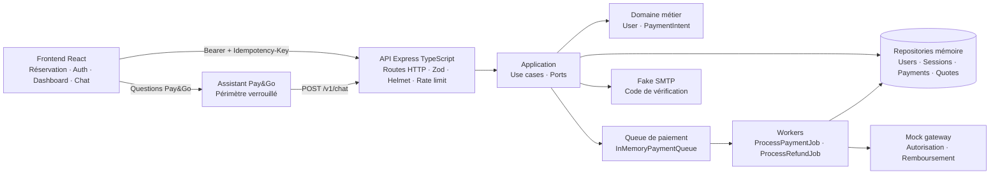
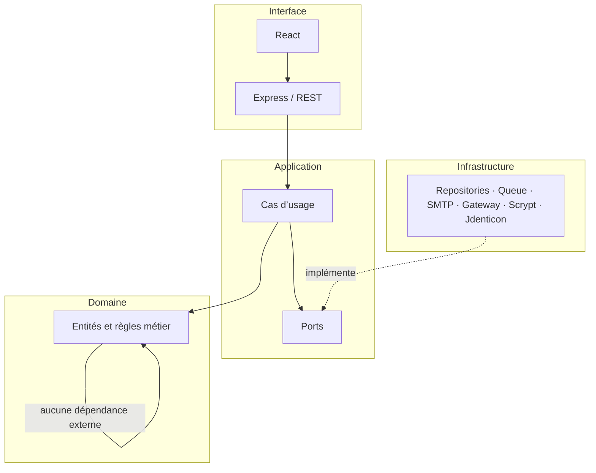
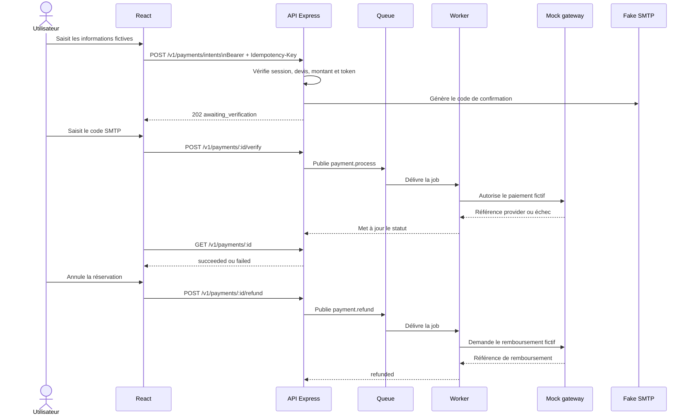

# Pay&Go — schéma d’architecture

Ce document décrit les frontières du système de démonstration. Le frontend ne transmet jamais les données bancaires complètes : il crée un token fictif, puis l’API contrôle le devis, l’idempotence et l’identité de l’utilisateur.

## Vue d’ensemble



## Règle de dépendance



Le domaine ne connaît ni Express, ni PostgreSQL, ni Redis, ni le fournisseur de paiement. Les ports décrivent les besoins de l’application et les adaptateurs d’infrastructure les implémentent. `backend/api/src/main.ts` est le composition root qui assemble les dépendances.

## Parcours paiement et remboursement



## Documentation API

Après le démarrage de l’API, la documentation interactive est disponible ici :

- Swagger UI : `http://127.0.0.1:4000/docs`
- Spécification OpenAPI JSON : `http://127.0.0.1:4000/openapi.json`

La spec couvre la santé du service, l’authentification, la session Bearer, la création idempotente d’un paiement, la vérification SMTP, la consultation d’état, le remboursement et l’assistant Pay&Go à périmètre verrouillé.

## Accès administrateur local

Le rôle admin est attribué uniquement aux emails listés dans `ADMIN_EMAILS` au démarrage de l’API. Exemple PowerShell :

```powershell
$env:ADMIN_EMAILS = 'admin@payandgo.local'
npm run api:start
```

Il faut ensuite créer ce compte depuis l’écran d’inscription. Le menu du profil affiche alors `Administration`, qui consomme les endpoints protégés `/v1/admin/overview` et `/v1/admin/scaling`. Cette attribution par email est prévue pour la démonstration locale ; en production, elle doit être remplacée par un annuaire d’identités, un rôle persisté et une politique d’accès séparée.

## Déploiement PostgreSQL et services paiement

Le mode conteneurisé active `STORAGE_DRIVER=postgres` et `QUEUE_DRIVER=postgres`. Le service `payment-api` expose les routes REST et publie les jobs dans PostgreSQL ; le service `payment-worker` réclame les jobs avec `FOR UPDATE SKIP LOCKED`, exécute le gateway fictif puis met à jour l’intention. La queue est interchangeable : `InMemoryPaymentQueue` reste disponible pour les tests unitaires, tandis que `PostgresPaymentQueue` permet de séparer et scaler les workers.

Le schéma et les devis de réservation sont créés par `infra/database/init/001_schema.sql`. PostgreSQL l’exécute automatiquement au premier démarrage du volume Docker. Pour réappliquer explicitement le script sous Windows :

```powershell
npm run db:init
docker compose -f infra/docker-compose.yml up --build
```

Les services Docker sont alors disponibles sur `http://localhost:5500`, `http://localhost:4400` et `http://localhost:4400/docs/` par défaut. Les ports peuvent être ajustés avec `PAYANDGO_WEB_PORT`, `PAYANDGO_API_PORT` et `PAYANDGO_DB_PORT`. Les données de démonstration restent fictives ; aucune carte bancaire réelle ne doit être envoyée à l’API.

## Remplacement pour la production

Les adaptateurs mémoire peuvent être remplacés sans modifier le domaine ni les cas d’usage :

| Démonstration | Production |
| --- | --- |
| Repositories mémoire | `Postgres*Repository` avec contraintes uniques |
| `InMemoryPaymentQueue` | `PostgresPaymentQueue`, puis Redis Streams, RabbitMQ, SQS ou Kafka |
| `FakeSmtpMailer` | Fournisseur SMTP réel avec secrets manager |
| `MockPaymentGateway` | PSP certifié avec tokenisation hébergée |
| Token de session mémoire | Cookie `HttpOnly` sécurisé ou OIDC/OAuth2 |

Le paiement réel doit rester hors du périmètre de l’application : les données carte doivent être saisies dans un composant hébergé par un PSP certifié et ne jamais transiter par l’API Pay&Go.
