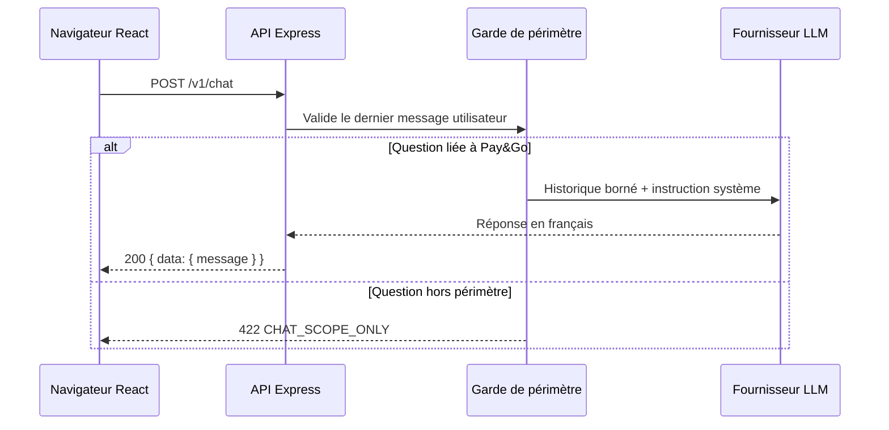

# Pay&Go — assistant conversationnel

## Objectif

L’assistant aide uniquement sur le périmètre fonctionnel de Pay&Go : recherche de trajets, réservation, paiement fictif, vérification SMTP, remboursement, compte, connexion et navigation dans l’application.

Il ne sert pas d’assistant généraliste et ne peut pas exécuter d’action d’administration, de paiement ou de remboursement.

## Flux



## Verrou de périmètre

La validation est réalisée côté API avant tout appel au fournisseur :

- l’historique est limité à 12 messages côté validation et à 8 messages côté frontend ;
- le dernier message utilisateur doit contenir un terme lié au transport, à la réservation, au paiement, au compte ou à Pay&Go ;
- une question hors sujet renvoie `422` et le message `CHAT_SCOPE_ONLY` ;
- le prompt système demande également au modèle de refuser les demandes hors sujet et les demandes de données sensibles ;
- le fallback local applique la même règle si l’API ou le fournisseur est indisponible.

Ce filtre lexical est adapté à la démonstration. En production, il doit être complété par un classifieur dédié, une liste de catégories autorisées, des tests adversariaux et une revue des journaux sans contenu sensible.

## Sécurité

- `OPENAI_API_KEY` reste dans l’environnement du backend et n’est jamais envoyé au navigateur ;
- `POST /v1/chat` est limité à 20 requêtes par minute par instance ;
- le corps JSON global est limité à 32 KB ; chaque message est limité à 1 000 caractères ;
- l’appel fournisseur est limité à 15 secondes ;
- les secrets, données bancaires, CVV, mots de passe et clés API sont explicitement interdits dans les réponses attendues ;
- aucune capacité d’outil n’est exposée au modèle.

## Configuration

```powershell
$env:OPENAI_API_KEY = 'cle-fourni-par-le-secret-manager'
$env:OPENAI_MODEL = 'gpt-4o-mini'
$env:OPENAI_BASE_URL = 'https://api.openai.com/v1'
npm run api:start
```

Docker Compose reprend ces variables pour `payment-api`. Une clé réellement exposée doit être révoquée et remplacée ; elle ne doit jamais être placée dans `front/`, dans un commit ou dans le bundle Vite.

## Réponses d’erreur

| Statut | Code | Signification |
| --- | --- | --- |
| 200 | — | Réponse Pay&Go générée |
| 400 | `INVALID_CHAT_REQUEST` | Historique ou contenu invalide |
| 422 | `CHAT_SCOPE_ONLY` | Question hors périmètre |
| 502 | `CHAT_UNAVAILABLE` | Fournisseur indisponible |
| 503 | `CHAT_UNAVAILABLE` | Clé serveur non configurée |

## Fichiers

- `backend/shared/src/application/chat/ChatTopicGuard.ts` : règle de périmètre.
- `backend/shared/src/application/ports/ChatAssistant.ts` : contrat applicatif.
- `backend/shared/src/infrastructure/chat/OpenAIChatAssistant.ts` : adaptateur fournisseur.
- `backend/api/src/main.ts` : validation HTTP et limitation de débit.
- `front/src/features/chat/chatClient.js` : client frontend sans secret.
- `front/src/components/chat/Chatbot.jsx` : interface et fallback local.
