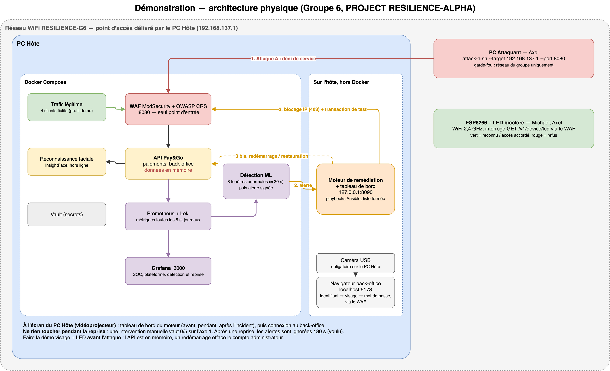

# Dossier d'ingénierie et de gouvernance

> Version 0.2 du 21/10/2026, avant les essais. Les sections marquées **À compléter** attendent les mesures des répétitions (WOR-78, WOR-79). Chaque pilier relit sa section avant le rendu.
>
> Les détails techniques restent dans le dépôt Git ; chaque section renvoie aux fichiers concernés.

## 1. En bref

- **Le besoin.** Un opérateur de paiement fictif (200 commerçants partenaires, 1,2 million de transactions par jour) met 30 minutes ou plus à rétablir son service après un incident. Au-delà de 30 minutes en heure de pointe, un arrêt coûte environ 700 k€, surtout en pénalités contractuelles, et devient probablement un incident majeur au sens de DORA.
- **Notre réponse.** Une plateforme de paiement qui **détecte seule** une anomalie par apprentissage automatique, **déclenche seule** une remédiation encadrée, puis **prouve** le retour du service par une vraie transaction de test.
- **Deux incidents.** Un déni de service (attaque A, scénario principal), qui appelle une reprise de la disponibilité ; une injection applicative (attaque B), qui appelle le traitement d'une compromission. Les deux réponses sont différentes, comme le demande le sujet.
- **La consigne additionnelle 1.** Le back-office exige le visage de l'administrateur avant son mot de passe, verrouille un identifiant après 2 échecs, et une LED pilotée par un ESP8266 affiche le résultat de chaque connexion.
- **Le tout sur un seul PC Hôte**, déployé par Ansible et Docker Compose, attaqué depuis un PC distinct sur le réseau `RESILIENCE-G6`.
- **La gouvernance** relie les risques (EBIOS RM), les objectifs de reprise, le PCA/PRA et DORA aux composants réels, et dit ce que le prototype prouve et ne prouve pas.

## 2. Architecture et flux

### 2.1 Vue d'ensemble

Source modifiable : `docs/dossier/architecture-demo.drawio` (draw.io).

Trois flux : **le trafic** (clients et attaquant → WAF → API) ; **l'observation** (métriques toutes les 5 s, journaux de tous les conteneurs) ; **la réaction** (alerte signée → moteur → playbook → vérification par transaction).

### 2.2 Rôle des composants

| Composant | Rôle | Technologie | Où |
|---|---|---|---|
| WAF | Seul point d'entrée exposé ; bloque les injections (403) ; applique la liste d'IP bloquées par la remédiation | nginx, ModSecurity, OWASP CRS niveau 1 | `infra/waf/` |
| API de paiement « Pay&Go » | Comptes, sessions, intentions de paiement idempotentes, vérification, métriques et journaux | Node.js, Express, TypeScript | `services/payment-api/` |
| Observabilité | Collecte des métriques (5 s) et des journaux (rétention 7 jours) ; tableaux de bord SOC, plateforme, détection et reprise | Prometheus, Loki + Alloy, Grafana | `infra/` |
| Secrets | Mots de passe et clés rendus en mémoire aux services | HashiCorp Vault, Vault Agent | `infra/vault/` |
| Détection | Fenêtres de 60 s évaluées toutes les 10 s, deux familles (trafic, injection) ; alerte après 3 fenêtres anormales | Python, scikit-learn (Isolation Forest + enveloppe statistique) | `ml/` |
| Moteur de remédiation | Reçoit les alertes, exécute une liste fermée de playbooks, vérifie la reprise, journalise chaque étape | Python, FastAPI, Ansible | `services/remediation/`, `ansible/playbooks/remediation/` |
| Tableau de bord d'incident | État du service avant, pendant et après l'incident | React | `services/dashboard/` |
| Double authentification du back-office | Identifiant, puis visage par la caméra, puis mot de passe ; verrouillage après 2 échecs | InsightFace (hors ligne), Node.js | `services/face-recognition/`, `services/payment-api/` |
| Objet connecté | LED rouge ou verte qui reflète l'état de la connexion au back-office | ESP8266, PlatformIO | `iot/led-indicator/` |
| Trafic légitime | Quatre clients fictifs qui se connectent et paient en continu | Python | `ml/lab/traffic/` |
| Assistant RAG | Répond aux opérateurs à partir des runbooks et de la gouvernance, sans aucun droit d'action | LangChain, Ollama (qwen2.5 7B) | `rag/` |

### 2.3 Réseaux

| Réseau | Qui | Particularité |
|---|---|---|
| `edge` | WAF, trafic légitime | Seul le WAF y publie un port |
| `backend` | WAF, API, PostgreSQL | Interne : aucun accès sortant |
| `monitoring` | Prometheus, Loki, Grafana, API, détection | Grafana exposé le jour de la démo ; le reste en local |
| `secrets` | Vault, Vault Agent | Vault en local uniquement |
| `docker-api` | Alloy, proxy du socket Docker | Interne : seul Alloy lit le socket, à travers le proxy |

### 2.4 Choix structurants

| Choix | Pourquoi | Ce qu'il coûte |
|---|---|---|
| Loki plutôt qu'Elastic | Mémoire limitée du PC Hôte | Recherche moins riche |
| Détection non supervisée (Isolation Forest) | Peu d'exemples d'attaque ; on apprend le normal | Le taux de détection n'est mesurable qu'en essai |
| Moteur de remédiation sur l'hôte | Il pilote Docker par Ansible | Il a les droits Docker de l'utilisateur (risque R3, §7) |
| API du socle sans base de données | Intégration rapide derrière le WAF | Un redémarrage ou une restauration efface les transactions (§7) |
| Déploiement par Ansible | Vault doit être descellé avant le reste ; installation en une commande (`scripts/setup.sh`) | Un simple `docker compose up` ne suffit pas |

## 3. L'incident

| | Attaque A — déni de service (principale) | Attaque B — injection (secondaire) |
|---|---|---|
| Vecteur | Rafale de requêtes depuis le PC Attaquant | Entrées malformées contre l'API |
| Effet | Latence et erreurs en hausse, paiements en échec | Tentative d'altérer les données ou de contourner l'authentification |
| Réponse attendue | **Rétablir la disponibilité** | **Traiter une compromission** : bloquer, revenir à un état sain, qualifier l'incident |
| Script | `attack/scenario-a-dos/attack-a.sh` | `attack/scenario-b-injection/attack-b.sh` |

Les deux scripts **refusent toute cible publique** : seuls la machine locale et le réseau du groupe sont autorisés (WOR-66).

## 4. Détection et reprise

### 4.1 Détection

Le service de détection lit Prometheus et Loki toutes les 10 s et calcule des indicateurs sur une fenêtre de 60 s : débit, latences, erreurs, nombre d'IP distinctes et part de la plus active pour le trafic ; blocages du WAF, règles d'injection déclenchées, caractères suspects pour l'injection. Une fenêtre est anormale si l'Isolation Forest **ou** l'enveloppe statistique la juge hors norme. Après **trois fenêtres anormales consécutives**, il envoie une alerte avec les IP sources : celles qui pèsent au moins 20 % parmi les 5 plus actives.

### 4.2 Contrat entre la détection et la remédiation

L'alerte est signée (HMAC-SHA256, clé hors Git). Le moteur refuse une alerte non signée, vieille de plus de 60 s ou déjà reçue. Seule cette route déclenche une action (`docs/architecture/contrat-alerte-remediation.md`).

### 4.3 Réaction

| Alerte | Actions, dans l'ordre |
|---|---|
| Déni de service | Blocage en 403 des IP sources au WAF (rechargement à chaud) → transaction de test → si elle échoue, redémarrage de l'API → vérification |
| Injection | Blocage des IP sources → contrôle de l'API → recréation du conteneur de l'API (état sain connu) → vérification |

**Vérification :** un incident n'est résolu qu'après une transaction de test complète à travers le WAF : connexion, intention de paiement, code, paiement réussi. Jusqu'à 6 essais espacés de 3 s. Après **2 tentatives en échec**, le moteur s'arrête et demande une intervention humaine (`docs/runbooks/reprise.md`). Les IP de l'hôte ne sont jamais bloquées. Après un redémarrage ou une restauration, le moteur ignore les alertes pendant 180 s, le temps que les clients se reconnectent.

### 4.4 Budget de temps

| Étape | Budget A | Budget B |
|---|---|---|
| Impact → anomalie visible (collecte à 5 s) | ≤ 5 s | ≤ 5 s |
| Anomalie → alerte (3 fenêtres) | ≈ 30 s | ≈ 30 s |
| Alerte → action terminée | ≤ 20 s | ≤ 2 min |
| Action → transaction de test réussie | ≤ 10 s | ≤ 20 s |
| **RTO visé** | **≤ 60 s** | **≤ 3 min** |

Le RTO se mesure depuis la première transaction en échec, pas depuis l'alerte (`docs/gouvernance/cible/rto-rpo.md` §6).

## 5. Résultats des essais

**À compléter** après les répétitions (trois essais par attaque, pire cas retenu).

| Mesure | Attaque A | Attaque B |
|---|---|---|
| Délai de détection (impact → alerte) | | |
| RTO mesuré (impact → transaction réussie) | | |
| Transactions perdues ou dupliquées | | |
| Intervention humaine nécessaire | | |

Déjà mesuré :

- **WAF :** 9 vecteurs d'injection sur 10 bloqués en 403 (`infra/waf/README.md`).
- **Détection :** réentraînée sur 7,3 h de trafic de la plateforme ; environ une fausse alerte de trafic toutes les 7 h, aucune d'injection en validation. Une seule requête d'injection bloquée par le WAF est détectée. Délai de détection des attaques A et B à mesurer (`ml/training/README.md`).

## 6. Sécurité

| Mesure | Où |
|---|---|
| WAF bloquant devant l'API, seul port exposé au réseau | `infra/waf/` |
| Connexion : 12 essais par 15 min, identifiant verrouillé après 2 échecs (5 min, puis 10, 15…) ; visage exigé avant le mot de passe pour le back-office ; seules les empreintes faciales sont conservées, jamais les images | `services/payment-api/`, `services/face-recognition/` |
| Secrets dans Vault, rendus en mémoire aux services ; aucun mot de passe dans l'environnement des conteneurs du socle | `infra/vault/` |
| Conteneurs durcis : utilisateur non-root, capacités retirées, limites de CPU et de mémoire | `infra/docker-compose.yml` |
| Réseaux internes sans accès sortant ; socket Docker derrière un proxy | `infra/docker-compose.yml` |
| Moteur de remédiation encadré : alertes signées, anti-rejeu, liste fermée de playbooks, écoute hors réseau | `services/remediation/` |
| Assistant RAG en lecture seule, sans droits ni accès à Docker | `rag/` |
| SOC / SIEM dans Grafana : blocages du WAF, accès à Vault, flux corrélés | `infra/grafana/` |
| Journaux exportables avec empreintes SHA-256 pour l'investigation | `scripts/export-logs.sh` |
| Scripts d'attaque limités au réseau du groupe | `attack/` |

**Points ouverts**, suivis dans `docs/gouvernance/constat/etat-implementation.md` : l'API du socle garde ses données en mémoire ; le moteur de remédiation a les droits Docker de l'hôte ; le déploiement autonome de Pay&Go expose sa base (port 55432) avec un mot de passe dans le dépôt ; l'API renvoie le code de vérification des paiements ; une tentative d'injection bloquée par le WAF déclenche quand même la restauration ; les visages enrôlés sont des données biométriques réelles (consentement et effacement à prévoir, cadre RGPD dans `docs/governance/rgpd-biometrie.md`) ; la reconnaissance faciale ne détecte pas une photo présentée à la caméra, le mot de passe reste donc indispensable.

## 7. Gouvernance : risques, reprise et conformité

### 7.1 Ce qu'un arrêt coûte

En heure de pointe : environ 1,5 k€ jusqu'à 5 minutes, 10 k€ jusqu'à 30 minutes, puis **700 k€** jusqu'à 2 heures, parce que le budget d'arrêt mensuel du contrat (43 minutes) est dépassé. **La reprise automatique est l'investissement prioritaire** : elle maintient un déni de service dans la tranche la moins chère.

### 7.2 Risques (EBIOS RM)

| Risque | Résiduel actuel | Ce qui le traite |
|---|---|---|
| R1 déni de service sur l'API | Modéré (sous réserve du RTO mesuré) | Limite par client, détection, blocage, redémarrage vérifié |
| **R2 injection et altération des transactions** | **Élevé** | WAF bloquant ; mais une seule tentative, même bloquée, déclenche la restauration qui efface toutes les transactions |
| **R3 détournement du moteur de remédiation** | **Élevé** | Signature et liste fermée ; reste les droits Docker et la restauration sur une seule alerte |
| R5 exfiltration de la base | Significatif tant que le port 55432 est exposé | Fermer le port, secrets dans Vault |
| R7 rançongiciel sur l'hôte | Significatif, **accepté** | Hors prototype : sauvegardes hors site, deuxième site |

R2 et R3 illustrent le paradoxe du sujet : la défense automatique fait baisser R1, mais elle devient elle-même le bien le plus sensible, et une restauration automatique trop sensible fait plus de dégâts que l'attaque qu'elle traite. Le 21/10, deux fausses alertes d'injection ont ainsi effacé les transactions sans aucune attaque ; le détecteur a été réglé depuis.

### 7.3 Objectifs de reprise

| Service | RTO métier | RPO métier | Cible démo |
|---|---|---|---|
| Paiement (API) | ≤ 5 min | 0 transaction perdue | ≤ 60 s (A), ≤ 3 min (B) |
| Journaux | ≤ 1 h | 0 journal perdu | Export avant toute restauration |

**Le RPO de 0 n'est pas tenu aujourd'hui** : l'API du socle garde ses données en mémoire. Nous l'affichons plutôt que de le masquer.

### 7.4 PCA / PRA

Sept fiches scénarios, chacune avec signaux, actions, objectif, escalade et risques résiduels : déni de service, injection, panne sans attaque, fausse alerte, moteur détourné, fuite de données, perte de l'hôte. Quatre niveaux de réponse, de l'automate seul (N0) à la crise majeure (N3). La remise à l'état sain entre deux essais n'est **jamais** une reprise après un incident réel : elle efface aussi les preuves.

### 7.5 DORA et NIS2

L'entreprise est un établissement de paiement : **DORA s'applique**, NIS2 non (annexe I). Un déni de service repris en moins de 5 minutes reste sous les seuils d'un incident majeur ; une reprise manuelle de 30 minutes ou plus le rend probablement majeur, avec notification à l'ACPR (4 h après la classification). Une injection avec perte de données est majeure **quelle que soit la vitesse de reprise**.

| Le prototype démontre | Il ne peut pas démontrer |
|---|---|
| Détection, réponse et reprise vérifiée (art. 10, 11) ; classification d'un incident (art. 18) ; cartographie des risques (art. 6, 8) | Redondance et sauvegardes hors site (art. 12) ; tests indépendants (art. 26) ; contrats avec les prestataires (art. 28) ; rôle de la direction (art. 5) |

### 7.6 Arbitrages et décisions demandées

| Arbitrage | Pour la démo | En production |
|---|---|---|
| Automatique ou humain | Tout automatique, humain en cas d'échec | Humain pour valider les restaurations (REC-2) |
| Une ou deux preuves avant une action destructrice | Une alerte suffit | Deux signaux concordants (REC-3) |
| Restauration après injection | Retour à l'état de départ, transactions perdues | Restauration à un instant précis, sans perte (REC-6) |
| Hébergement | Un hôte, risque accepté | Deuxième site, sauvegardes hors site (REC-5, REC-9) |

Nous demandons à la direction de **valider la reprise automatique** pour la disponibilité, d'**accepter le risque de l'hôte unique** pour la phase pilote en budgétant les sauvegardes hors site, et de **nommer les rôles du PCA**.

Documents complets : `docs/gouvernance/cible/` (EBIOS RM, services critiques, NIS2/DORA, RTO/RPO, PCA/PRA, recommandations) et `docs/gouvernance/constat/etat-implementation.md`.

## 8. Contribution de chacun

| Membre | Pilier | Ce qu'il ou elle a réalisé |
|---|---|---|
| **Michael** | Développement | Application Pay&Go : API de paiement, authentification, front web et page d'administration, documentation OpenAPI, tests (PR #14 ; WOR-33 à WOR-42) |
| **Reza** | Infrastructure | Socle Docker Compose, Prometheus, Loki et Alloy, Grafana, HashiCorp Vault, déploiement par Ansible et installation en une commande (PR #3, #4, #9, #11, #12 ; WOR-43 à WOR-49, WOR-62) |
| **Léa** | IA / Data | Jeu de données et indicateurs, modèle de détection et son réglage sur le trafic de la plateforme, service d'inférence, moteur de remédiation et tableau de bord, tableaux Grafana, assistant RAG (PR #5, #10, #26, #50, #53, #55 ; WOR-38, WOR-50 à WOR-57) |
| **Axel** | Cybersécurité | Scénarios et scripts d'attaque avec garde-fou de périmètre, WAF, SOC / SIEM, durcissement, export des journaux et investigation, remise à l'état sain, intégration de l'API derrière le WAF, reconnaissance faciale et double authentification du back-office, verrouillage des comptes, objet connecté ESP8266, réorganisation du dépôt (PR #1, #2, #6, #7, #16 à #21, #24, #29, #30, #47 à #49, #51, #52 ; WOR-29, WOR-58 à WOR-66, WOR-90, WOR-95 à WOR-100) |
| **Cédric** | Gouvernance | EBIOS RM, coût d'un arrêt, NIS2/DORA, RTO/RPO, PCA/PRA, recommandations, constat du code face à la gouvernance, générateur de PDF et site de la documentation (PR #8, #13, #15, #22, #23, #25, #27, #28 ; WOR-31, WOR-67 à WOR-73) |

**À compléter par chacun** : relire sa ligne, ajouter ce qui manque (revues, intégration, essais).

## 9. Où trouver le reste

| Sujet | Fichier |
|---|---|
| Installer et lancer la plateforme | `README.md`, `scripts/setup.sh` |
| Spécification des attaques | `docs/attack-scenarios.md` |
| Contrats entre la plateforme, la détection et la remédiation | `docs/architecture/` |
| Runbooks d'incident et de reprise | `docs/runbooks/` |
| Rapport d'entraînement du modèle | `ml/training/report.md` |
| Gouvernance complète | `docs/gouvernance/` |
| Biométrie et RGPD (double authentification du back-office) | `docs/governance/rgpd-biometrie.md` |
| Démonstration de la double authentification et de la LED | `docs/demo-mfa-led.md` |
